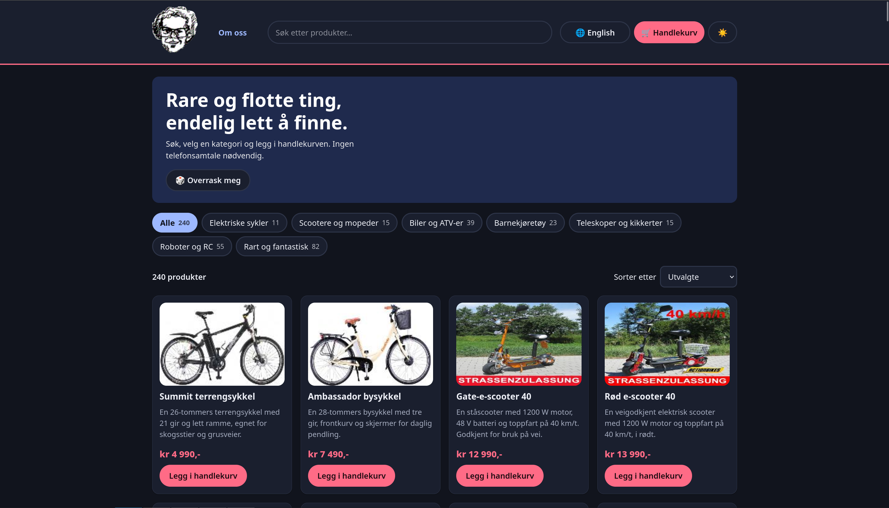
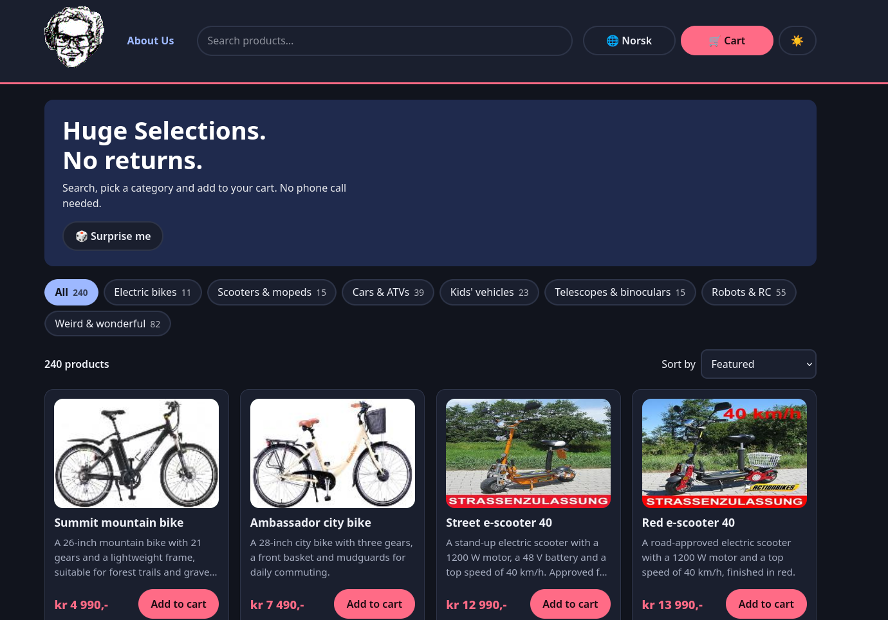
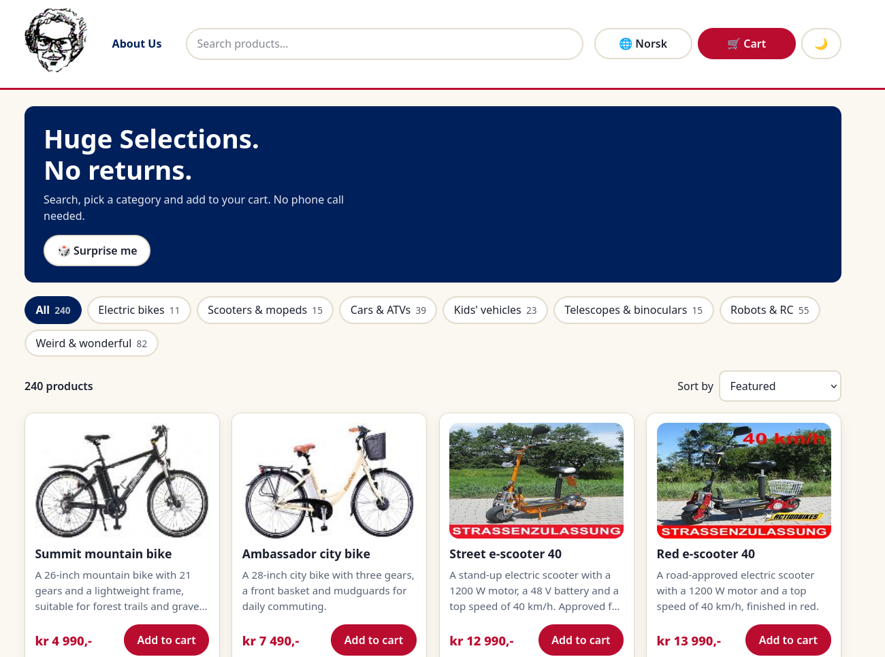
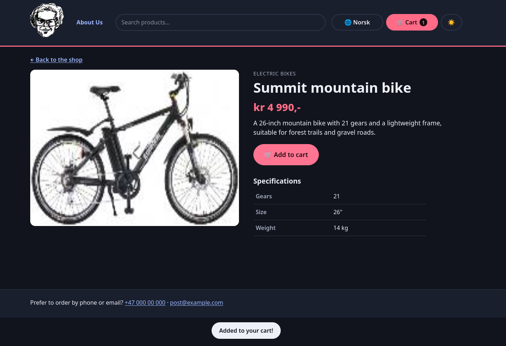
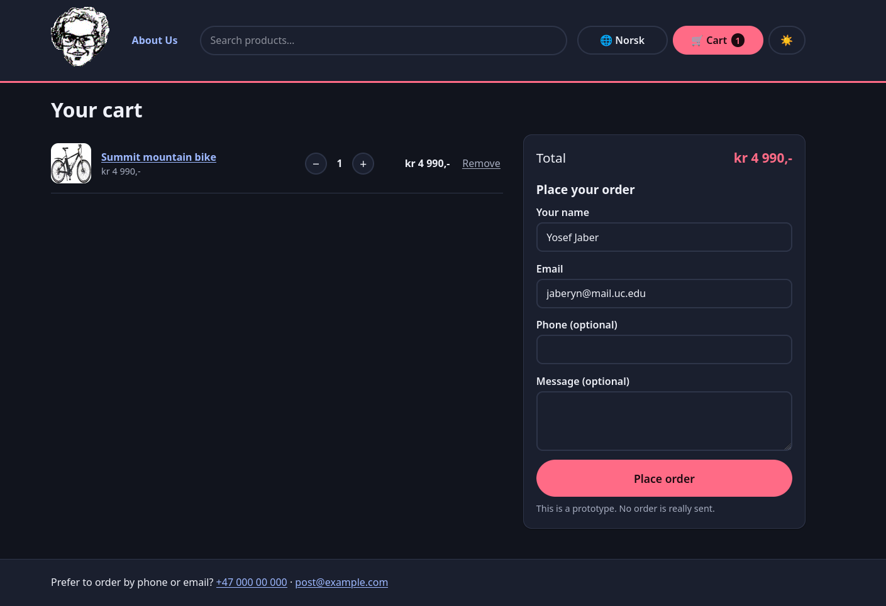
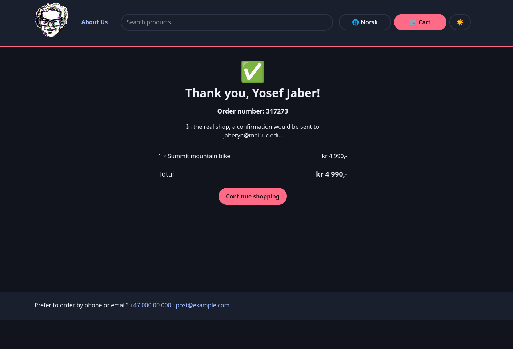

# arngren2

# Documentation
We rebuilt arngren.net, a famously bad website that is run by Frithjof Arngren. The website is made to sell e-bikes, cars, scooters, and anything else he feels like selling. The pages are built from hundreds of absolutely placed boxes, animated GIFs, and tons of differnt fonts. Our redesign ripped 1100 pictures from the original website before filtering out all the ones that were unusable to a point where we have 240 different products. We have also added new features like a cart, english translation, and dark mode. This is all while making the website much more readable and understanable.

Original arngren.net

Our Redesigned arngren.net

## Features

### Dark/Light Mode
A moon/sun button in the header switches the whole site between a light and a dark theme. The site starts in whichever theme the visitor's computer is set to, and the choice applies to every page. All colors are CSS variables defined once in `src/app.css`, with a light set and a dark set. A small effect in `App.svelte` puts the choice on the page as data-theme, and the dark values override the light ones. Both themes have high contrast and readability and the dark mode helps users who might want a more pleasent experience when browsing late at night. 

Dark Mode

Light Mode

### English Translation

The original website was mostly in Norwegian, with some English mixed in on a few pages. Letting visitors switch to English opens the shop up to a whole new market of people who could not read it before. To do this we added a button in the header that switches the whole website between English and Norwegian. It translates the menus, buttons, error messages, product names, product descriptions and the labels in the specification tables. It works with a dictionary in `src/lib/translations.js` that has two lists, one English (en) and one Norwegian (no), with the same keys in both, like `addToCart`. Wherever the interface shows text, the code asks for it by key, for example `t('addToCart')`, and gets the text in the current language back. Product names and descriptions live in `src/lib/products.js`, each with an English and a Norwegian version. The button only changes the language setting, and the whole page updates by itself. The site also starts in Norwegian if the browser is set to Norwegian, and search finds products in both languages.

Must be stated that the norweigan language translation was done with claude so it might be wrong.

### Cart

The original website had no cart. Customers had to order through phone or email which adds time and frustration to the whole process. To make the user experience more pleasent we have added a cart. When visiting a product page you can add the item to the cart and then go to the cart page and checkout.

\
*Add item to cart*

\
*Check out*

\
*Checked out*

### About Page
The About page keeps the personality of the original shop. It tells the story of Frithjof Arngren and his journey in building the hoverpod, a flying seated vehicle.

## Redesign

### Home/Store Page

### Product Page
For the home page, we replaced the original’s hundreds of absolutely placed boxes, which had no order and made the page wider than the screen, with one clear structure: a header, an intro, a category bar, a product grid and a footer. It is built with CSS grid and flexbox, so it reflows from one column on a phone to several on a desktop. Products that were once shown in different sizes and styles now share a single card with a photo, name, price and an Add to cart button. Where the original had no search, there is now a search box in the header that filters as you type. The fonts and colors that used to change from box to box are now one font, three text sizes and a small palette of Norwegian flag red and navy.

The page also has a few extras. Surprise me button opens a random product, a nod to the original, where you never know what you will find. The category bar shows how many products are in each category, and a sort menu offers Featured, price low to high and price high to low. If nothing matches a search, a friendly empty state appears with a Clear search button.

# Critique and redesign exploration

## UI that fits

## Redesign research, data, planning

## Sketch and feedback

## Feedback