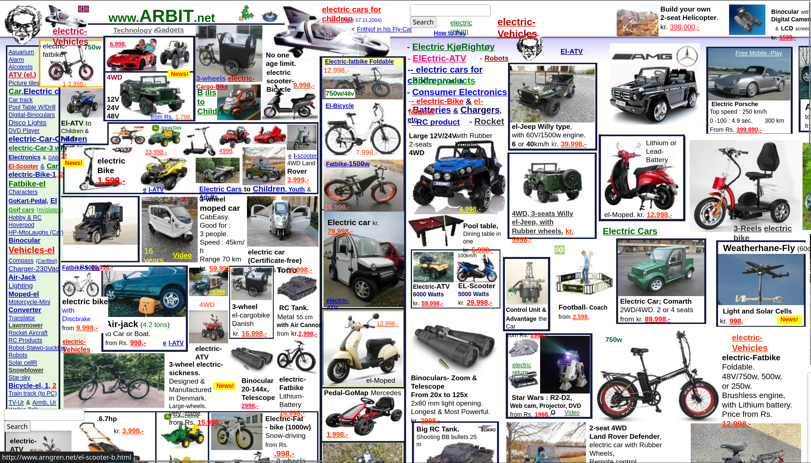

# arngren2

# Documentation
We rebuilt arngren.net, a famously bad website that is run by Frithjof Arngren. The website is made to sell e-bikes, cars, scooters, and anything else he feels like selling. The pages are built from hundreds of absolutely placed boxes, animated GIFs, and tons of differnt fonts. Our redesign ripped 1100 pictures from the original website before filtering out all the ones that were unusable to a point where we have 240 different products. We have also added new features like a cart, english translation, and dark mode. This is all while making the website much more readable and understanable.

Original arngren.net

Our Redesigned arngren.net

## Features

### Dark/Light Mode

### English Translation

### Cart

### About Page

## Redesign

### Home/Store Page

### Product Page

# Critique and redesign exploration

## UI that fits

## Redesign research, data, planning

## Sketch and feedback

## Feedback